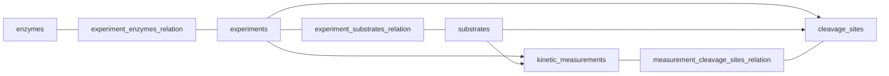

# Kinetics contract, version 1.0

One dataset is eight linked tables. `KineticsDataset` loads and validates the
whole bundle. The executable schema is
[`integration/kinetics/schema.py`](../src/proteolysis_data_manager/integration/kinetics/schema.py).
All acquisition/normalization applies to BRENDA only at this stage. Cross-source
and cross-family enrichment, MEROPS overlap and fragment searches are deferred.

## Relationships



Both experiment relations have composite primary keys. A peptidase can occur in
many experiments; an experiment can refer to several enzymes/substrates. A
measurement-to-site link must refer to the same experiment and substrate.
An optional `cleavage_sites.enzyme_id` must belong to that experiment.

## Primary and join keys

| Table | Primary key | Foreign keys / join target |
|---|---|---|
| `enzymes` | `enzyme_id` | — |
| `substrates` | `substrate_id` | — |
| `experiments` | `experiment_id` | — |
| `experiment_enzymes_relation` | (`experiment_id`, `enzyme_id`) | `experiment_id` → `experiments`; `enzyme_id` → `enzymes` |
| `experiment_substrates_relation` | (`experiment_id`, `substrate_id`) | `experiment_id` → `experiments`; `substrate_id` → `substrates` |
| `kinetic_measurements` | `measurement_id` | `experiment_id` → `experiments`; nullable `substrate_id` → `substrates` |
| `cleavage_sites` | `site_id` | `experiment_id` → `experiments`; `substrate_id` → `substrates`; nullable `enzyme_id` → `enzymes` |
| `measurement_cleavage_sites_relation` | (`measurement_id`, `site_id`) | `measurement_id` → `kinetic_measurements`; `site_id` → `cleavage_sites` |

Use these IDs for joins; reported names and sequences are descriptive values, not
join keys. The two experiment relations are many-to-many bridges. A direct join
from measurements through enzyme/substrate/site bridges can multiply rows. For
per-measurement summaries, aggregate each association by its owning ID first or
use `measurements_view()`, which keeps enzyme and site IDs in lists. A site link
is valid only when measurement and site share both `experiment_id` and
`substrate_id`; it records an explicit source association and is never inferred
by sequence search.

## Columns, in contract order

`source` is a nonempty sorted list of source names. `source_record_id` is a list
of `{source, id}` references, as in half-life. Scalars are nullable except IDs
and required relationship keys. Optional lists use null when undocumented.
List-valued UniProt accessions preserve source ambiguity rather than selecting
one accession. `publication_id` lists PMIDs or source-scoped reference IDs;
`publication_urls` contains available PubMed links. Every raw BRENDA reference
remains accessible through the source record locator, including references with
no PMID.

| Table | Columns |
|---|---|
| enzymes | enzyme_id, source, source_record_id, name_reported, ec_number, uniprot_accession, enzyme_species, enzyme_variant_reported, description_raw |
| substrates | substrate_id, source, source_record_id, name_reported, substrate_type, sequence, sequence_length, chirality, topology, n_terminal_modification, c_terminal_modification, other_modifications |
| experiments | experiment_id, source, source_record_id, publication_id, publication_urls, assay_method_raw, in_vivo_in_vitro, species, matrix, matrix_fraction, temperature_c, ph, buffer_raw, conditions_raw |
| experiment_enzymes_relation | experiment_id, enzyme_id, enzyme_link_status |
| experiment_substrates_relation | experiment_id, substrate_id |
| kinetic_measurements | measurement_id, experiment_id, substrate_id, parameter_type, value_numeric, value_unit, value_relation, measurement_scope, sd, ci_lower, ci_upper, ci_level, replicate_count |
| cleavage_sites | site_id, experiment_id, substrate_id, enzyme_id, position_reported, coordinate_basis, bond_reported, site_text_raw, cleavage_context_p4_to_p1, cleavage_context_p1prime_to_p4prime, cleavage_context_8aa, context_origin, source_locator |
| measurement_cleavage_sites_relation | measurement_id, site_id |

IDs/text are strings; positions, sequence lengths and replicate counts are
nullable int64; measurements, uncertainty and pH/temperature/fraction are
nullable float64. List columns use Arrow lists, not delimited strings.
No `value_raw`, `assignment_basis_raw` or `substrate_role_raw` column is added.

## Source interpretation and missingness

- Each BRENDA kinetic entry becomes one source experiment context and one
  measurement. This does **not** establish an independent experiment or replicate.
  Matching PMIDs, protein IDs or substrate labels do not merge contexts.
- IDs are deterministic for source JSON locators within the reviewed release.
  Another release is a separate snapshot, not an automatic cross-release merge.
- Enzyme organisms/accessions come from the linked BRENDA protein block.
  Several source protein links use `reported_group_unresolved`; they do not
  create independent measurements or prove a multi-enzyme complex.
- Explicit variant-bearing comments create separate enzyme descriptions. Missing
  variant information never means wild type. The source wording is retained.
- Identical substrate names and explicit chemistry within an EC share a
  source-scoped dictionary record. This is a label identity, not resolved chemical
  identity; no cross-source equivalence is claimed. Abbreviations such as `more`
  remain source labels with unknown type and sequence.
- Substrate type uses conservative lexical rules for common proteins,
  residue-named peptides and reporter substrates. It is descriptive, not a gate.
  Sequences and chemistry are not reconstructed from compound names.
- `species` describes the assay sample; `enzyme_species` describes the enzyme.
  Enzyme tissue/organism and general activity optima are not assay conditions.
- pH and temperature are read only from a single explicit scalar in the entry
  comment. Ranges, comparisons, optimum statements and conflicting mentions
  remain null. Full comments are retained in `conditions_raw`.
- The baseline adapter does not infer serum/plasma, dilution, in-vitro mode,
  assay method or CI from free text. These remain null pending focused curation.
  `buffer_raw` preserves a buffer mention, not a complete parsed formulation.
- Chemistry gaps may later be enriched across the three independent data families;
  that operation is outside this version and will require verified identity.

## Parameters and units

| Source family | parameter_type | value_unit | Numerical conversion |
|---|---|---|---|
| turnover_number | kcat | s^-1 | unchanged |
| km_value | km | M | mM × 0.001 |
| kcat_km_value | kcat_km | M^-1 s^-1 | inverse mM/s × 1000 |

Unit evidence: [BRENDA field definitions](https://www.brenda-enzymes.org/datafields.php)
and [kcat/Km search fields](https://www.brenda-enzymes.org/search_result.php?a=305).
The field-definition page has an inconsistent `mM/s` heading for kcat/Km;
the search form specifies inverse concentration/time. The conversion is explicit
in the normalization manifest, not inferred by dividing unrelated measurements.

`value_relation`: eq, lt, le, gt, ge, range, approx, unknown. Only a reported
nonnegative finite point populates `value_numeric`. Ranges/bounds/approximations
remain null with the source expression in raw and a concrete entry in remarks.
Negative sentinels remain unknown. A reported center ± untyped error retains
the center, but does not imply SD or CI. Uncertainty units equal `value_unit`.
Missing CI/SD stay null; no synthetic uncertainty is computed.

## Reported cleavage annotations

Position numbering is one-based: `position_reported=i` denotes the bond after
residue i of the stated coordinate basis. `coordinate_basis` distinguishes
substrate sequence, parent-protein sequence or unresolved source numbering.
No positions or substrates are looked up in MEROPS or searched in another sequence.
Only a reported, unambiguous position and the matching reported sequence permit
direct slicing into P4–P1 and P1′–P4′ contexts. Complete 8aa contexts require
four residues on each side; no padding is invented.

The BRENDA kinetic families have no structured site field. This adapter leaves
site tables typed and empty; comments and substrate/product descriptions remain
raw for a separate review. An empty table means **no structured annotations
extracted**, not no cleavage occurred or no mention exists in the literature.
`measurement_scope` therefore remains unknown for these records.

Future site-specific annotations use `site_specific` or `site_set` and the
measurement/site relation. Whole-substrate parameters (`substrate_total`) must
not be copied to every cleavage site.

## Reader and protocol exports

```python
from pathlib import Path
from proteolysis_data_manager.integration.kinetics.reader import load_kinetics_data

root = Path("data/proteolysis/kinetics_datasets")
dataset = load_kinetics_data(root)
view = dataset.measurements_view()  # exactly one row per measurement
enzyme_contexts = dataset.for_enzyme(dataset["enzymes"].enzyme_id.iloc[0])
reviewed = load_kinetics_data(root, condition="human_enzyme")
```

Reader validation covers schema metadata, checksums, primary/foreign keys,
experiment membership, measurement/site scope, units and uncertainty structure.
`for_enzyme` returns source associations, including unresolved group links;
it does not assert enzyme-specific parameter attribution. The flattened view
stores enzyme/site associations as lists, preventing Cartesian multiplication.

The single acquisition receipt is `raw/manifest.json`. Normalization and protocol
receipts are in `manifests/`. Protocols write the same eight
tables to `processed/<condition>/sources/brenda/`, including empty tables and
accepted nonnumeric measurements. No redundant full-width CSV or report files
are generated. A final multi-source aggregate is deferred until review.

## Protocol filter and meaning of the output

The current `human_enzyme` protocol joins
`experiment_enzymes_relation.enzyme_id` to `enzymes.enzyme_id` and groups links
by `experiment_id`. It accepts a context only when every linked enzyme has a
reported species and the complete set is exactly `Homo sapiens`. Contexts with
unknown, mixed, or otherwise non-human enzyme species are excluded. It then
exports all measurements belonging to accepted contexts, including nonnumeric
and condition-incomplete measurements; numerical eligibility is a diagnostic,
not an additional filter.

This is **not a human-serum filter** and does not describe the distribution of
measurements made in human serum. In the current configuration, assay sample
`species`, `matrix` (serum/plasma), and `in_vivo_in_vitro` filters are unset, and
pH/temperature acceptance bounds are disabled. Thus the output describes
BRENDA measurement records linked to contexts with exclusively human enzyme
associations, across whatever assay samples and conditions BRENDA reports (or
leaves undocumented). It is a source-record distribution, not a count of
independent experiments, replicates, all human proteases, or a serum-specific
population. The protocol output path `processed/human_enzyme/` names the enzyme
selection only.
