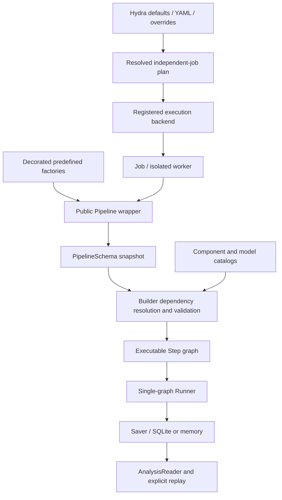

# Technical Architecture

This document describes how PepCompass constructs and executes an
optimisation pipeline.

> Remarks:
> - Public configuration belongs to the [User Guide](user-guide.md).
> - Modification procedures belong to the [Developer Guide](developer-guide.md).
> - Why the packages below are split this way belongs to
>   [Architecture Decisions](architecture-decisions.md).

## System Architecture

PepCompass isolates *construction* (validating configuration and wiring
components into an executable graph) from the *components* themselves
(walkers, mutation generators, filters, oracles, interchangeable strategy
families behind abstract contracts) and from *running experiments*
(planning, backends, persistence). This lets the same components be combined
into different pipelines, and lets the pipeline itself be built and run from
plain Python without YAML, CLI or persistence.

### Core

`core.wrapper` owns the public editable `Pipeline` and component factories.
`core.builder` receives an explicitly prepared catalog, resolves dependencies, validates declarations through
`core.builder.validation` and constructs the executable Step graph. Schemas and
run settings live in `data_schemas`; algorithms live in `optimization`.

### Autoencoder

`pep_compass.autoencoder` (`base.py`, `registry.py`, `factory.py`,
`geometry.py`, `strategies/hydramp/`) owns the autoencoder contract, its
strategy registry, and geometric operations derived from the decoder
Jacobian (`field_derivative`, tangent-space decomposition consumed by SORBES
and MUTANG). `AutoencoderFactory.build(method, model, device, **parameters)`
separates the *implementation* (`method`, e.g. `hydramp`) from the *named
checkpoint* (`model`, e.g. `article_25`) — see
[Architecture Decisions](architecture-decisions.md#autoencoder-not-models).

### Data schemas

`data_schemas.graph` contains immutable `PipelineSchema`/node declarations;
`specification` contains the neutral computation specifications consumed by the
builder. `candidates` defines aligned candidate batches and fields, `execution`
defines runner settings and limits, `results` defines run results, and
`dataset`/`result_schema` define the logical analysis view and historical formats.
The removed `data` namespace has no compatibility forwarding modules.

### Registries

`registry.factories.registry.Registry` implements decorator registration,
parameter validation and service injection. Its immutable registration records
are in `factories.definitions`; parameter helpers are in `factories.parameters`.
`registry.components.catalog` maps component families to registries;
`components.manager` is their shared facade, `components.loading` explicitly
imports built-ins, and `components.contracts` exposes cardinality information.
`components.families` owns typed family registries and their common managers;
`components.registrations` owns built-in factory declarations. Internal SORBES,
MUTANG and ranked-filter catalogs live in `registry.strategies`.
`registry.models.definitions`, `models.catalog` and `models.provenance` separate
artifact declarations, lookup/validation and build-scoped provenance capture.
`registry.pipelines` owns preset registration, `registry.execution` owns backend
registration, and `registry.serialization` owns scientific payload registration.
Imports use these definition modules directly. There is no `core`/`base` alias
or separate duplicate bootstrap path in the registry.

### Optimisation Engine

`pep_compass.optimization` defines the executable graph and the science:

- `engine/execution/` — `Step`, `OptimizationContext`, `OptimizationState`,
  `OptimizationResult`: generic, method-agnostic execution machinery.
- `engine/operations/` — `Flow`, `Loop`, `Parallel` (+ merge policies),
  `LocalEnumeration`: composite control-flow operations.
- `components/{walkers,mutation_generators,filters,oracles}/` — independent
  strategy families, each with a `manager.py` registry and a `strategies/`
  package. `filters/` further splits into `direct/` (self-contained
  transformations) and `ranked/` (`ScoreFunction` + `SelectionRule`
  composition).
- `stability_estimation/` — static memory bounds and a runtime memory
  monitor (see [Stability Estimation](#stability-estimation)).
- `pipeline.py` — `PepCompassPipeline`, the public executable object; it can
  be constructed and run manually (no `core`, YAML or CLI required), or
  obtained from `core.builder.PipelineBuilder`.

### Orchestrator

`orchestrator.configuration` composes Hydra defaults and group substitutions.
`planning` validates and freezes independent wrapper jobs without loading weights.
`runner.Orchestrator` delegates dispatch to decorated `backends` strategies;
each worker invokes `Pipeline.from_schema(...).run(...)`. Server-specific Slurm
shell templates and custom strategies require no changes to the compute engine.
See the [orchestration guide](tutorial/orchestrator.md).

### Tracking and Analysis

Tracking observes step execution and writes runtime events; it is not stored
in `CandidateBatch` and cannot change optimisation fields, candidate count or
step order. `pep_compass.analysis` reads persisted results after execution
and does not participate in candidate transformations — see the
[Analysis Guide](analysis-guide.md).

## Construction and execution

The same wrapper path serves manual Python and orchestrated execution. Backend
strategy selection determines where jobs execute, not their computational graph.
Hydra sweeps expand configurations; input batching expands jobs within each plan.

## Pipeline Elements

### Candidate Data Model

`Candidate` contains `sequence` and `latent_origin` — the concrete latent
point that generated the sequence, never replaced by the mean of re-encoding
that sequence.

`CandidateBatch` (`data_schemas/candidates.py`) stores sequences as one tuple,
latent origins as a tensor with batch dimension first, and algorithm data as
named `fields`. It is immutable; every transformation returns another batch.
Field types:

- `TensorField` — candidate-aligned tensor;
- `ObjectField` — candidate-aligned Python objects;
- `SharedField` — one value shared by the whole batch;
- `OptionalField` — adds a validity mask when merged branches do not all
  provide the same field.

`select(indices)` applies one index set to sequences, latent origins and
every field, so a filter cannot silently misalign a score or geometry
column. `repeat_from_parents(parent_indices)` duplicates every parent-aligned
column for one-to-many expansion; a mutation generator then replaces
sequences with `with_sequences` while every child retains its parent's exact
latent origin. `CandidateBatch.concatenate` combines branch outputs in branch
order; a field present in only a subset of branches becomes optional.

### Step Contract

Every node in the executable graph — leaf component or composite — inherits
`Step` (`engine/execution/step.py`) and implements only `_execute(batch,
context) -> CandidateBatch`. `precompute(context)` prepares state reusable
for the entire run; `prepare_iteration(batch, context)` refreshes state that
depends on the current batch. Subclasses must not override `__call__`: it
enters a scoped context, runs `prepare_iteration`, samples memory before and
after, drives the tracker's `begin_step`/`end_step`/`fail_step`, times the
call, and only then delegates to `_execute`. Tracking is therefore automatic
— a strategy implementation never calls the tracker itself.

### Optimisation Context and State

`OptimizationContext` (`engine/execution/context.py`) carries the
autoencoder, tracker, execution `scope`, seed, NumPy `rng`, `state` and
stability monitor through the tree. `enter_step`/`enter_iteration` extend the
scope without changing the seed or RNG. `enter_branch(name, index)` derives
an **independently seeded** context (`seed + index + 1`, fresh
`np.random.default_rng`), so parallel branches are reproducible and
independent of completion order; every other context copy shares one
`OptimizationState`.

`OptimizationState` (`engine/execution/state.py`) holds, run-scoped:

- **oracle observations** — indexed by objective and sequence, so later
  selection reads observation history instead of requiring every batch to
  retain a score column;
- **trust-region state** — per objective, centre sequence/position, best
  score, radius, success/failure counters;
- **resource counters** — evaluated sequences and generated candidates,
  attached to tracking records before and after each step;
- **stop requests** — set when a limit is reached; `Loop` tests it (and
  whether the batch is empty) before another iteration.

## Execution Graph

### Flow

`Flow(steps)` passes the output of each child to the next; it does not
interpret fields or insert missing operations. A configuration `steps:` list
becomes one `Flow`.

### Loop

`Loop(body, iterations)` runs a `Flow` body a fixed number of times per
nested `iteration[N]` scope, stopping early on a global stop request or an
empty batch.

### Parallel and Batch Merging

`Parallel(branches, execution, merger)` gives every branch the same
immutable input batch. `sequential` (default) runs branches in order;
`concurrent` uses one worker thread per branch — branch completion order
never affects merged candidate order, since outputs are read back in
configuration order and merged by branch index. `ConcatenateMerger` is the
only implemented policy; `interleave`, `select_best` and `weighted_sample`
are declared (`MergeMethod` literal) but raise `NotImplementedError` (see
[Architecture Decisions](architecture-decisions.md#known-issues)).
Both execution modes share one `OptimizationState`; concurrent branches can
therefore update counters, observations and trust regions concurrently and
are not transactionally isolated.

### Local Enumeration

`LocalEnumeration` (`engine/operations/local_enumeration.py`) composes one
`walker` and one `mutation_generator` into a bounded trajectory-exploration
operation used by the reference LE-BO pipeline, keeping the continuing SORBES
trajectory point separate from the MUTANG candidate pool it emits — MUTANG
candidates do not automatically become the next SORBES step's input.

For every input seed, `trajectories` independent branches walk from that
seed. At every step: the walker advances one position; if
`include_walk_points` is true, the decoded walk point itself is emitted
(minus transient walker-only fields); the mutation generator expands that
point and the configured `filters` (a small `Flow` of `filter` steps,
typically distance/plausibility constraints scoped to
`local_enumeration.center_sequence`) run immediately after, and that
filtered batch is also emitted. Only the walk point continues to the next
iteration — mutations are collected, not walked from. Global deduplication,
selection, oracle evaluation and Bayesian optimisation remain ordinary steps
placed *after* `LocalEnumeration`, not inside it.

Termination is exactly one of `iterations` (fixed step count) or `walk_time`
(accumulated adjusted SORBES time per trajectory). `trajectory_execution:
batched` (default) advances active trajectories as one batched tensor call
inside an isolated forked Torch RNG stream (`torch.random.fork_rng`), removing
finished trajectories from the batch under a `walk_time` bound;
`trajectory_execution: sequential` runs one
trajectory at a time as a correctness reference and per-trajectory tracking
identity.

`local_enumerations.csv` (see [Tracking](#tracking)) records each execution's
input checkpoint path, input count, output count and a SHA-256 digest of the
output sequences. The checkpoint shard stores the exact input sequences,
latents, lineage identifiers and RNG states; the output list is not duplicated
in the CSV table. `analysis.reader.RunReplay.local_enumeration_input` and
`.verify_local_enumeration` (see [Analysis Guide](analysis-guide.md))
reconstruct and verify one execution's output against that digest.

## Execution implementation notes

- Every job builds an independent wrapper graph and shared autoencoder resource.
  A Python application can explicitly inject a resource for local use.
- Oracles own evaluation batching. Budget thresholds stop at complete-batch
  boundaries; already evaluated peptides remain in objective archives.
- Failures propagate through Step and the runner. The orchestrator writes a
  failed job status and applies `orchestrator.continue_on_error` to later jobs.
- Completed-result skipping validates the saved schema, inputs, settings, package
  source digest and recorded model artifacts; it never resumes partial execution.

## Stability estimation

`core.estimation` and `optimization.stability_estimation` expose static candidate
and memory bounds. Registered output-bound contracts are shared with graph
validation. Unknown data-dependent bounds remain unknown. Execution statistics
and retained step observations are available through the shared result reader.

## Tracking and result retention

`optimization.engine.runner.Runner` creates isolated state and RNG scopes.
`optimization.saving.saver.Saver` receives Step lifecycle events and oracle
observations, then writes the common logical tables through a memory or SQLite
backend. `base` retains evaluated sequence/objective entries and aggregate
statistics. Reconstruction boundaries, trajectories, component details,
observation history, lineage and terminal batches are independent retention
options, described in the [wrapper guide](tutorial/wrapper.md).

Each persistent run contains `settings.json` and `results.sqlite`. Model artifact
hashes, package source identity and resolved settings support explicit replay.
`AnalysisReader` opens lazy table handles without reconstructing computations.
`analysis.reader` additionally reads historical CSV/JSON/PT archives;
`analysis.reader.archives.schema` translates their recorded declarations for
replay. The obsolete runtime execution API and its import aliases are removed.
